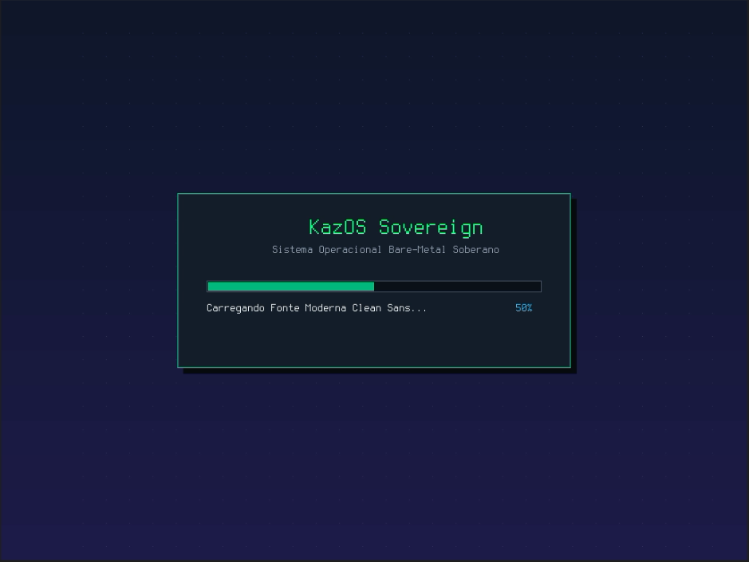
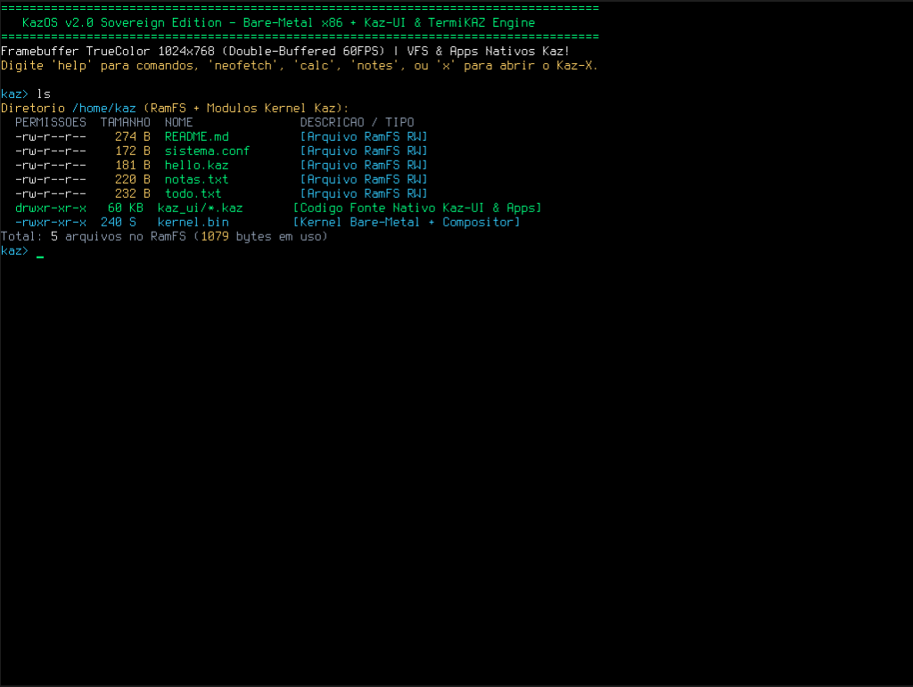
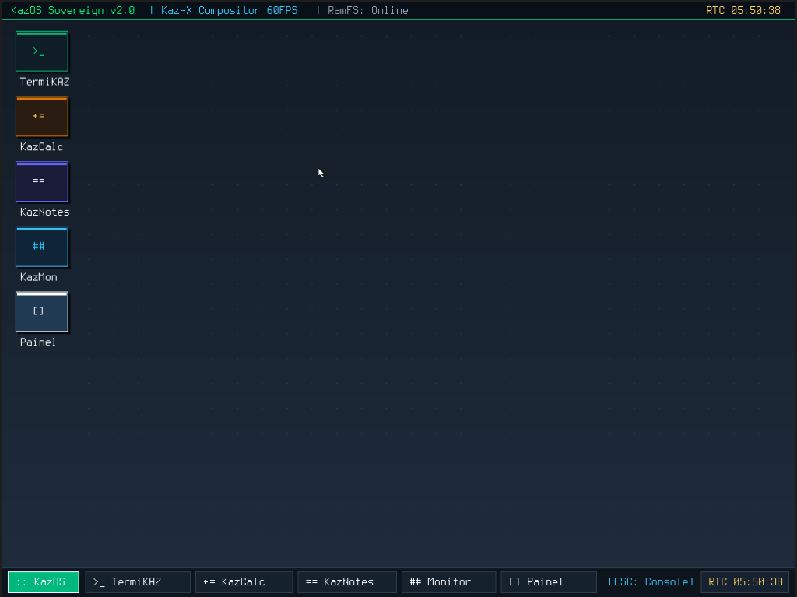

<p align="center">
  
</p>

<h1 align="center">KazOS Sovereign Prototype v2.0</h1>

<p align="center">
  <b>Protótipo Bare-Metal x86 com Compositor Gráfico Kaz-X e Suíte de Aplicativos Escritos 100% em Kaz</b><br />
  <i>Transparência Técnica Radical: Sem firula, sem maquiagem e com engenharia de verdade.</i>
</p>

<p align="center">
  <a href="#-download-da-imagem-live-iso"></a>
  
  
  
</p>

---

## 🎯 O que é o KazOS?

O **KazOS** é um **protótipo de sistema operacional bare-metal x86** construído com um objetivo muito claro e honesto: **demonstrar na prática a maturidade, capacidade de baixo nível e poder de computação da linguagem de programação Kaz**.

Não se trata de uma distribuição Linux modificada, não há Electron, nem Node.js, nem Python, nem X11/Wayland de terceiros por trás. Ao dar boot, a máquina física ou virtual executa diretamente o código compilado da linguagem controlando o hardware, gerenciando memória, teclado PS/2, mouse, relógio RTC CMOS e renderizando um ambiente gráfico completo double-buffered a 60 FPS com resolução 1024x768 TrueColor.

---

## 🔍 Auditoria de Soberania Técnica (Fato x Realidade)

Para evitar qualquer tipo de propaganda enganosa ou mistificação técnica comum na internet, apresentamos a divisão cirúrgica e exata do que compõe o KazOS hoje:

### 🟢 O que é 100% Kaz Puro (`kaz_ui/*.kaz` — 1.758 linhas de Kaz):
* **Compositor Gráfico & Window Manager (Kaz-X):** Toda a arquitetura de janelas, foco, Z-ordering (camadas de profundidade), arrastar e soltar (drag & drop), minimizar, maximizar, restaurar e hit-testing do mouse.
* **Ambiente Desktop Completo:** Barra de tarefas inferior, dock lateral de lançadores rápidos, menu iniciar com lista de aplicações, relógio RTC na barra e múltiplos temas visuais dinâmicos.
* **Shell Interativo (ksh v2.0):** Parser de comandos, execução em tempo real, controle de histórico e manipulação do RamFS.
* **Suíte de Aplicativos Nativos:**
  * **KazCalc:** Calculadora gráfica com suporte a teclado e botões visuais.
  * **KazNotes:** Editor de texto com gravação e leitura direta no RamFS.
  * **KazMon:** Monitor de recursos do sistema e kernel.
  * **Terminal Gráfico:** Console integrado com emulação de texto.
* **VFS em Memória (RamFS):** Estruturas de inode, criação, leitura, edição e exclusão de arquivos em RAM.

### 🟡 O que ainda NÃO é Kaz (Hardware Abstraction Layer / HAL):
* **Bootloader (`boot.asm` — 146 linhas Assembly x86):** Código de setor de boot MBR de 512 bytes responsável por acordar a CPU em Modo Real 16-bit, configurar o modo de vídeo VESA VBE linear (`0x4118` — 1024x768x24/32bpp) e chavear a CPU para Modo Protegido 32-bit.
* **Trampolim de Entrada (`kernel_entry.asm` — 20 linhas Assembly x86):** Alinhamento da pilha e chamada da função de entrada.
* **HAL de Baixo Nível (`kernel.c` — ~1.600 linhas C):** Atua estritamente como ponte de hardware:
  * Tabela de Descritores de Interrupção (IDT);
  * Controlador de Interrupções PIC 8259 e timers PIT;
  * Driver de portas I/O do Mouse PS/2 (`0x60`/`0x64`) e Teclado;
  * Cópia direta de backbuffer em RAM para a VRAM física (`0xFD000000`).

---

## 🗺️ O Plano de Reescrita: Rumo a 100% Kaz

O objetivo futuro deste projeto é reduzir a camada em C ao mínimo teórico indispensável. O que impede reescrever o restante em Kaz hoje e como isso será resolvido:

1. **Intrínsecos de Portas I/O na Linguagem Kaz:**
   * Assim que o compilador do Kaz implementar as instruções primitivas `sys_inb` e `sys_outb`, **os drivers de mouse PS/2, teclado e disco ATA serão 100% reescritos em Kaz puro**.
2. **Manipulação de Memória Física Direta:**
   * Com ponteiros físicos de baixo nível (`sys_peek32` / `sys_poke32`), a rotina de `swap_buffers` que joga a cena para a VRAM será transferida para Kaz.
3. **O que permanecerá em Assembly:**
   * Apenas os 512 bytes do setor de boot MBR (`boot.asm`), pois a arquitetura do processador x86 inicia historicamente em 16-bit real mode antes de qualquer compilador de 32/64 bits poder rodar.

---

## 📸 Galeria do Protótipo em Execução

<div align="center">

### 1. Tela de Carregamento (Splash com Barra de Progresso)
*Exibida na transição do console para a interface gráfica, informando a montagem dos subsistemas.*
<br /><br />


<br /><br />

### 2. Console Terminal Fullscreen (ksh v2.0)
*Prompt bare-metal com comandos utilitários, RamFS e histórico de navegação.*
<br /><br />


<br /><br />

### 3. Ambiente Gráfico Kaz-X com Multi-Janelas e Aplicativos Nativos
*Compositor a 60 FPS rodando simultaneamente o Terminal Gráfico, Calculadora, Notas e Painel.*
<br /><br />


<br /><br />

### 4. Desktop Limpo (Wallpaper Geométrico e Dock Soberano)
*Design minimalista com alta definição tipográfica e monitor de status do sistema.*
<br /><br />


</div>

---

## 💾 Download da Imagem Live ISO

A imagem híbrida oficial do KazOS está disponível diretamente neste repositório:

* 💿 **Arquivo:** [`iso/kazos_live.iso`](iso/kazos_live.iso) *(Tamanho: ~1.0 MB)*
* **Formato:** ISO 9660 Híbrida compatível com BIOS legada, ISOLINUX/MEMDISK e gravação direta em pendrive (USB DD).

---

## 🚀 Como Testar

### No QEMU (Linux ou Windows):
```bash
# Rodar direto como imagem de disco
qemu-system-x86_64 -drive format=raw,file=iso/kazos_live.iso

# Ou emular como drive de CD-ROM / ISO
qemu-system-x86_64 -cdrom iso/kazos_live.iso -boot d
```

### No VirtualBox:
1. Crie uma Máquina Virtual: Tipo: **Other**, Versão: **Other/Unknown (32-bit ou 64-bit)**, Memória: **128 MB**.
2. Em **Armazenamento (Storage)**, no drive de CD/DVD, aponte para o arquivo `kazos_live.iso`.
3. Inicie a máquina. O bootloader ISOLINUX carregará o KazOS instantaneamente.

### No PC Real (Pendrive Bootável):
* **Linux:** Grave a imagem no pendrive com o utilitário `dd`:
  ```bash
  sudo dd if=iso/kazos_live.iso of=/dev/sdX bs=4M status=progress && sync
  ```
* **Windows:** Use o **Rufus**. Selecione a ISO e grave preferencialmente em **Modo Imagem DD**.

---

## ⌨️ Controles Principais

| Tecla / Ação | Ação |
| :--- | :--- |
| `x` + `Enter` (no console) | Inicia o ambiente gráfico **Kaz-X** com Splash Screen. |
| `ESC` (na interface gráfica) | Abre a janela modal de confirmação: `[Enter: Sair]` / `[ESC: Cancelar e Ficar]`. |
| `Botão Esquerdo do Mouse` | Foca janelas, clica em botões, arrasta pela barra de título. |
| `Setas Cima / Baixo` | Navegação no histórico de comandos do shell. |

---

<p align="center">
  <b>Kaz Programming Language</b> • <a href="https://kazlang.xyz">kazlang.xyz</a> • Feito com foco, soberania e transparência.
</p>
