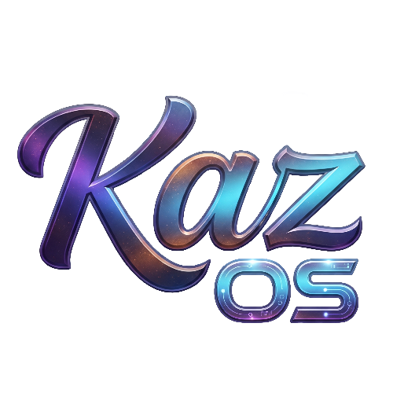
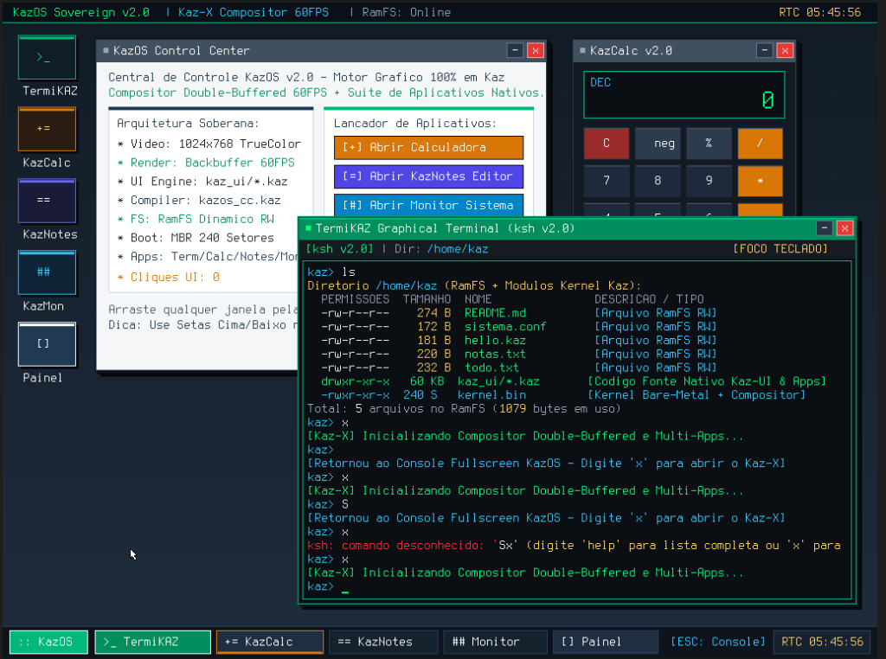

<p align="center">
  
</p>

<h1 align="center">KazOS Sovereign Prototype v2.0</h1>

<p align="center">
  <b>Bare-Metal x86 Prototype with Kaz-X Window Manager & Native Application Suite Written 100% in Kaz</b><br />
  <i>Radical Technical Transparency: No buzzwords, no makeup, just raw engineering facts.</i>
</p>

<p align="center">
  <a href="README.pt-BR.md">🇧🇷 Versão em Português disponível aqui</a>
</p>

<p align="center">
  <a href="#-download-the-live-iso"></a>
  
  
  
</p>

---

## 🎯 What is KazOS?

**KazOS** is a **bare-metal x86 operating system prototype** built with a single, honest purpose: **to empirically demonstrate the maturity, low-level execution power, and expressiveness of the Kaz programming language**.

This is not a modified Linux distribution. There is no Electron, no Node.js, no Python runtime, and no third-party display server (X11/Wayland). Upon boot, the physical or virtual machine executes directly compiled code from the Kaz toolchain: managing memory, handling PS/2 mouse and keyboard packets, reading real-time CMOS clocks, and rendering a fully double-buffered desktop environment at a rock-solid 60 FPS in 1024x768 TrueColor.

---

## 🔍 Technical Sovereignty Audit (Facts vs. Reality)

To maintain absolute integrity and avoid deceptive marketing, here is the exact breakdown of the codebase as it exists today:

### 🟢 100% Pure Kaz Code (`kaz_ui/*.kaz` — 1,758 lines of Kaz):
* **Compositor & Window Manager (Kaz-X):** Window creation, mouse focus, dynamic Z-ordering (depth layers), drag & drop mechanics, minimize, maximize, restore, and pixel-precise hit-testing.
* **Complete Desktop Shell:** Bottom taskbar with active application tabs, side dock launcher, Start Menu with app triggers, real-time RTC clock, and dynamic multi-palette color themes.
* **Interactive Terminal Shell (ksh v2.0):** Command interpreter, command line editing, history navigation (Up/Down arrows), and RamFS interaction.
* **Native Application Suite:**
  * **KazCalc:** Graphical scientific/integer calculator responding to both mouse buttons and keyboard input.
  * **KazNotes:** Text editor with live editing, in-memory saving, and instant reading from the RamFS.
  * **KazMon:** System and memory resource monitor showing Ring 0 services and VRAM status.
  * **Integrated Terminal:** Embedded graphical terminal window running the command shell.
* **In-Memory Virtual Filesystem (RamFS):** Inode tables, file creation, reading, appending, and deletion in RAM.

### 🟡 Hardware Abstraction Layer / HAL (Not yet in Kaz):
* **Bootloader (`boot.asm` — 146 lines x86 Assembly):** Real Mode 16-bit MBR code (512 bytes) that switches video modes via VESA VBE linear framebuffer (`0x4118` — 1024x768x24/32bpp LFB), loads the kernel sectors from disk, and switches CPU to 32-bit Protected Mode.
* **Kernel Entry Trampoline (`kernel_entry.asm` — 20 lines x86 Assembly):** Stack alignment and jump to entry point.
* **Low-Level HAL (`kernel.c` — ~1,600 lines C):** Strictly serves as a direct hardware bridge:
  * Interrupt Descriptor Table (IDT);
  * PIC 8259 controller setup and PIT timer;
  * PS/2 mouse and keyboard I/O port drivers (`0x60`/`0x64`);
  * Fast RAM backbuffer transfer (`swap_buffers`) directly to physical video memory (`0xFD000000`).

---

## 🗺️ The Roadmap: Rewriting Towards 100% Kaz

Our roadmap aims to reduce C dependencies to the absolute bare minimum required by x86 architecture constraints:

1. **CPU Port I/O Intrinsics in Kaz:**
   * Once the Kaz compiler implements `sys_inb` and `sys_outb` intrinsics, **the PS/2 mouse, keyboard, and ATA hard disk drivers will be rewritten 100% in pure Kaz**.
2. **Direct Physical Memory Addressing:**
   * With low-level pointer intrinsics (`sys_peek32` / `sys_poke32`), the `swap_buffers` blit routine will be migrated into Kaz.
3. **What will remain in Assembly:**
   * Only the 512-byte MBR boot sector (`boot.asm`), as x86 hardware inherently powers on in 16-bit Real Mode before any 32/64-bit compiler runtime can execute.

---

## 📸 Prototype Screenshots

<div align="center">

### 1. Animated Splash & Loading Screen
*Shown during initialization when transitioning from console to graphics mode.*
<br /><br />


<br /><br />

### 2. Fullscreen Console Terminal (ksh v2.0)
*Interactive bare-metal prompt featuring built-in RamFS commands and hardware diagnostics.*
<br /><br />


<br /><br />

### 3. Kaz-X Multi-Window Desktop & Native Suite
*60 FPS compositor concurrently managing the terminal, calculator, notes editor, and control panel.*
<br /><br />


<br /><br />

### 4. Clean Desktop (Minimalist Wallpaper & Dock)
*Modern typography, system tray, side launchers, and zero visual clutter.*
<br /><br />


</div>

---

## 💾 Download the Live ISO

The bootable hybrid ISO image is provided directly inside this repository:

* 💿 **File:** [`iso/kazos_live.iso`](iso/kazos_live.iso) *(Size: ~1.0 MB)*
* **Format:** Hybrid ISO 9660 compatible with Legacy BIOS, ISOLINUX/MEMDISK, and raw USB flash drive writing (DD mode).

---

## 🚀 How to Run & Test

### In QEMU (Linux or Windows):
```bash
# Boot as a raw disk image
qemu-system-x86_64 -drive format=raw,file=iso/kazos_live.iso

# Or emulate as an optical CD-ROM / ISO drive
qemu-system-x86_64 -cdrom iso/kazos_live.iso -boot d
```

### In VirtualBox:
1. Create a Virtual Machine: Type: **Other**, Version: **Other/Unknown (32-bit or 64-bit)**, RAM: **128 MB**.
2. Under **Storage**, attach `kazos_live.iso` to the virtual CD/DVD drive.
3. Start the virtual machine. The ISOLINUX loader will launch KazOS instantly.

### On Physical Hardware (Bootable USB):
* **Linux:** Flash the ISO using `dd`:
  ```bash
  sudo dd if=iso/kazos_live.iso of=/dev/sdX bs=4M status=progress && sync
  ```
* **Windows:** Use **Rufus**. Select the ISO and write in **DD Image Mode**.

---

## ⌨️ Essential Keyboard & Mouse Controls

| Key / Action | Result |
| :--- | :--- |
| `x` + `Enter` (in console) | Launches the graphical **Kaz-X** environment with splash screen. |
| `ESC` (in GUI) | Triggers confirmation modal: `[Enter: Confirm Exit]` / `[ESC: Cancel & Stay]`. |
| `Left Mouse Button` | Window focus, button clicks, titlebar dragging. |
| `Up / Down Arrows` | Shell command history recall in terminal. |

---

<p align="center">
  <b>Kaz Programming Language</b> • <a href="https://kazlang.xyz">kazlang.xyz</a> • Engineering-driven, sovereign, and transparent.
</p>
